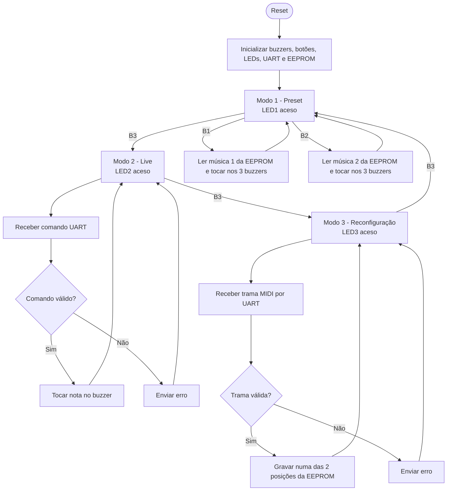

# Sistema Musical com 3 Buzzers

Firmware em C para um ATmega328P que toca música em três buzzers passivos.
Suporta músicas pré-guardadas na EEPROM (selecionadas por botão), controlo em
tempo real a partir do PC via UART e reconfiguração das músicas guardadas
através de uma trama do tipo MIDI.

> Campos marcados com `TODO` devem ser preenchidos com os valores finais do projeto.

## Índice

- [Objetivo](#objetivo)
- [Modos de funcionamento](#modos-de-funcionamento)
- [Hardware](#hardware)
- [Comunicação UART](#comunicação-uart)
- [Formato da trama de reconfiguração](#formato-da-trama-de-reconfiguração)
- [Implementação](#implementação)
- [Fluxograma](#fluxograma)
- [Limites atuais](#limites-atuais)
- [Estrutura do repositório](#estrutura-do-repositório)
- [Compilar e carregar](#compilar-e-carregar)
- [Prazos](#prazos)

## Objetivo

Sistema embebido que reproduz música em 3 buzzers (uma voz por buzzer),
alimentado por USB e controlado por botões e por um terminal série no PC.

## Modos de funcionamento

O botão B3 muda de modo. Um LED indica o modo ativo (LED1 = modo 1,
LED2 = modo 2, LED3 = modo 3). Todos os modos usam os 3 buzzers.

| Modo | Descrição |
| --- | --- |
| 1 – Preset | B1 toca a música 1 e B2 toca a música 2, ambas guardadas na EEPROM, nos 3 buzzers. |
| 2 – Live | O PC envia buzzer, frequência e duração por UART e os buzzers tocam em tempo real. |
| 3 – Reconfiguração | O PC envia uma trama do tipo MIDI; o sistema valida-a e grava-a na EEPROM (2 posições de preset). Os novos presets ficam guardados. |

## Hardware

Pinos usados no teste atual (placa Arduino com a mesma ligação do Tinkercad):

| Função | Pino Uno | Pino AVR |
| --- | --- | --- |
| Buzzer 1 | D8 | PB0 |
| Buzzer 2 | D9 | PB1 |
| Buzzer 3 | D10 | PB2 |
| Botão 1 (música 1 no modo preset) | D2 | PD2 |
| Botão 2 (música 2 no modo preset) | D3 | PD3 |
| Botão 3 (muda de modo) | D4 | PD4 |
| LED 1 (modo 1) | D5 | PD5 |
| LED 2 (modo 2) | D6 | PD6 |
| LED 3 (modo 3) | D7 | PD7 |
| UART RX/TX | D0/D1 | PD0/PD1 |

- Microcontrolador: ATmega328P a 16 MHz.
- Alimentação: USB (5 V).
- Placa final: PCB própria de 2 camadas, ≤ 80 × 60 mm, desenhada em Altium 365,
  com ponte USB-UART (por exemplo CH340) e conector ISP.
- Simulação do circuito em Tinkercad.
- Usar buzzers passivos para reproduzir diferentes frequências.
- Verificar a corrente exigida por cada buzzer e usar um transistor como driver
  quando necessário; não exceder o limite de corrente dos GPIO.

## Comunicação UART

Configuração: **9600 baud, 8 bits de dados, sem paridade, 1 stop bit (8-N-1)**.

### Modo live

Formato do comando:

```text
B<buzzer>_<frequência em Hz>_<duração em ms>
```

Exemplo (buzzer 1, 300 Hz, 250 ms):

```text
B1_300_250
```

- Gama de frequências: 262 Hz a 1976 Hz (C4 a B6).
- Gama de durações: 50 ms a 2000 ms.
- `TODO` confirmar o separador/terminador de comandos quando se enviam vários
  comandos seguidos.
- Cada comando recebe uma resposta de estado (aceite ou inválido).

## Formato da trama de reconfiguração

Trama do tipo MIDI enviada pelo PC no modo 3 (`TODO` definir campos finais):

| Campo | Tamanho | Descrição |
| --- | --- | --- |
| Cabeçalho | `TODO` | Marca de início da trama |
| Nº do preset | `TODO` | Posição da música na EEPROM (1 ou 2) |
| Nº de notas | `TODO` | Quantidade de eventos |
| Eventos | `TODO` | Nota, duração e buzzer de cada evento |
| Checksum | `TODO` | Validação da integridade |

- A trama só é gravada na EEPROM depois de validada.
- Em caso de erro, o preset anterior é mantido e é enviada uma mensagem de erro.

## Implementação

- `src/1,1.cpp` – sketch Arduino de teste (3 botões, 3 LEDs, 3 buzzers), usado
  para validar a ligação e os modos.
- Módulos previstos para o firmware final em C (avr-gcc), ainda por criar:
  `uart`, `main` (máquina de estados dos 3 modos), `buzzer`, `eeprom` e `midi`
  (validação e descodificação da trama).

## Fluxograma



## Limites atuais

- 2 músicas guardadas na EEPROM (presets 1 e 2).
- `TODO` número máximo de notas por música (proposta: ≥ 64 eventos).
- Gama de frequências: 262 Hz a 1976 Hz (proposta).
- A EEPROM do ATmega328P tem 1 KB, o que limita o espaço total para presets.
- A EEPROM tem um número limitado de ciclos de escrita; evitar regravações
  desnecessárias.

## Estrutura do repositório

```text
.
├── docs/        # requisitos, estado da arte, perguntas ao cliente, relatório E1
├── src/         # código
└── README.md
```

## Compilar e carregar

Toolchain prevista: `avr-gcc` com `Makefile`, `avrdude` e programador ISP.

`TODO` adicionar o `Makefile` e os comandos de compilação (`-Wall`) e de
carregamento com `avrdude`.

## Prazos

- E1: 26/10/2026 (tag `E1` no Git)
- E2: 05/11/2026
- E3: 14/12/2026
- PF: 28/01/2027
