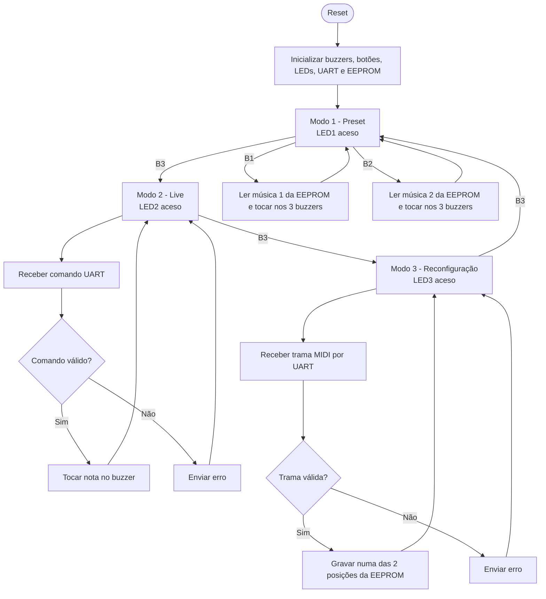

# Sistema Musical com 3 Buzzers

Firmware em C para um ATmega328P que toca música em três buzzers passivos.
Suporta músicas pré-guardadas na EEPROM (selecionadas por botão), controlo em
tempo real a partir do PC via UART e reconfiguração das músicas guardadas
através de uma trama do tipo MIDI.

## Índice

- [Objetivo](#objetivo)
- [Modos de funcionamento](#modos-de-funcionamento)
- [Hardware](#hardware)
- [Comunicação UART](#comunicação-uart)
- [Formato da trama de gravação](#formato-da-trama-de-gravação)
- [Implementação](#implementação)
- [Fluxograma](#fluxograma)
- [Limites atuais](#limites-atuais)
- [Estrutura do repositório](#estrutura-do-repositório)
- [Compilar e carregar](#compilar-e-carregar)
- [Prazos](#prazos)

## Objetivo

Sistema embebido que reproduz música em 3 buzzers (uma voz por buzzer),
alimentado por USB e controlado por botões e por um terminal série no PC.

## Modos de funcionamento

O botão B3 muda de modo. Um LED indica o modo ativo (LED1 = modo 1,
LED2 = modo 2, LED3 = modo 3). Todos os modos usam os 3 buzzers.

| Modo | Descrição |
| --- | --- |
| 1 – Presets | B1 toca a música 1 e B2 toca a música 2, guardadas na EEPROM. Cada buzzer reproduz a sua voz em simultâneo. |
| 2 – Live | O PC envia `B<buzzer>_<Hz>_<ms>` seguido de Enter; o buzzer indicado toca sem gravar a nota. |
| 3 – Gravação | O PC envia uma trama binária do conversor MIDI; a placa valida-a e grava o preset 1 ou 2 na EEPROM. |

## Hardware

Pinos usados no teste atual (placa Arduino com a mesma ligação do Tinkercad):

| Função | Pino Uno | Pino AVR |
| --- | --- | --- |
| Buzzer 1 | D8 | PB0 |
| Buzzer 2 | D9 | PB1 |
| Buzzer 3 | D10 | PB2 |
| Botão 1 (música 1 no modo preset) | D2 | PD2 |
| Botão 2 (música 2 no modo preset) | D3 | PD3 |
| Botão 3 (muda de modo) | D4 | PD4 |
| LED 1 (modo 1) | D5 | PD5 |
| LED 2 (modo 2) | D6 | PD6 |
| LED 3 (modo 3) | D7 | PD7 |
| UART RX/TX | D0/D1 | PD0/PD1 |

- Microcontrolador: ATmega328P a 16 MHz.
- Alimentação: USB (5 V).
- Placa final: PCB própria de 2 camadas, ≤ 80 × 60 mm, desenhada em Altium 365,
  com ponte USB-UART (por exemplo CH340) e conector ISP.
- Simulação do circuito em Tinkercad.
- Usar buzzers passivos para reproduzir diferentes frequências.
- Verificar a corrente exigida por cada buzzer e usar um transistor como driver
  quando necessário; não exceder o limite de corrente dos GPIO.

## Comunicação UART

Configuração: **9600 baud, 8 bits de dados, sem paridade, 1 stop bit (8-N-1)**.

### Modo live

Formato do comando:

```text
B<buzzer>_<frequência em Hz>_<duração em ms>
```

Exemplo (dois comandos enviados na mesma linha):

```text
B2_200_500 B3_100_200
```

- Gama de frequências: 100 Hz a 1976 Hz.
- Gama de durações: 50 ms a 2000 ms.
- Separar comandos com espaços e/ou Enter; cada um começa a tocar assim que é recebido.
- Duração `0` pára o buzzer indicado, ignorando a frequência: `B2_100_0`.
- Cada comando recebe `OK`, `OK: pausa` ou uma mensagem `ERRO`.

## Formato da trama de gravação

No modo 3, enviar a trama binária produzida por `src/midi_para_trama.py`:

| Campo | Tamanho | Descrição |
| --- | --- | --- |
| Cabeçalho | 1 byte | `0xAA` |
| Slot | 1 byte | Música a substituir: `1` ou `2` |
| Comprimento | 1 byte | Número de bytes dos eventos: 3 a 240, múltiplo de 3 |
| Eventos | 3 bytes cada | Canal/buzzer (1–3), nota MIDI (0 ou 60–95), duração em unidades de 10 ms (5–200) |
| Checksum | 1 byte | XOR de todos os bytes anteriores |

- Cada música aceita até 80 eventos. Nota `0` representa uma pausa nesse buzzer.
- A EEPROM só é atualizada depois de validar o slot, os eventos e o checksum.
- A placa responde `OK: musica ... gravada` ou `ERRO: ...`.
- Exemplo: `python src/midi_para_trama.py musica.mid --slot 1 --porta COM3`.

## Implementação

- Firmware em C (`.c`): `main`, `buttons`, `buzzer`, `presets`,
  `serial_modes` e `uart`. A inicialização e o ciclo principal implementam
  `setup()` e `loop()` em C para o core Arduino.
- `include/` – cabeçalhos com configuração e interfaces dos módulos.
- O acesso a GPIO, temporizador, UART e EEPROM é feito diretamente pelos
  registos AVR e pela biblioteca avr-libc; o código não depende da API C++
  `Serial`/`EEPROM`.
- `src/midi_para_trama.py` – conversor de ficheiros MIDI para a trama binária
  recebida no modo 3.

## Fluxograma



## Limites atuais

- 2 músicas guardadas na EEPROM (presets 1 e 2).
- Máximo de 80 eventos por música (240 bytes por preset, mais metadados).
- Gama de frequências live: 100 Hz a 1976 Hz.
- A EEPROM do ATmega328P tem 1 KB, o que limita o espaço total para presets.
- A EEPROM tem um número limitado de ciclos de escrita; evitar regravações
  desnecessárias.

## Estrutura do repositório

```text
.
├── docs/        # requisitos, estado da arte, perguntas ao cliente, relatório E1
├── src/         # código
└── README.md
```

## Compilar e carregar

Toolchain: PlatformIO, perfil Arduino Uno (`platformio.ini`). Compilar com
`pio run` e carregar com `pio run --target upload`.

## Prazos

- E1: 26/10/2026 (tag `E1` no Git)
- E2: 05/11/2026
- E3: 14/12/2026
- PF: 28/01/2027
