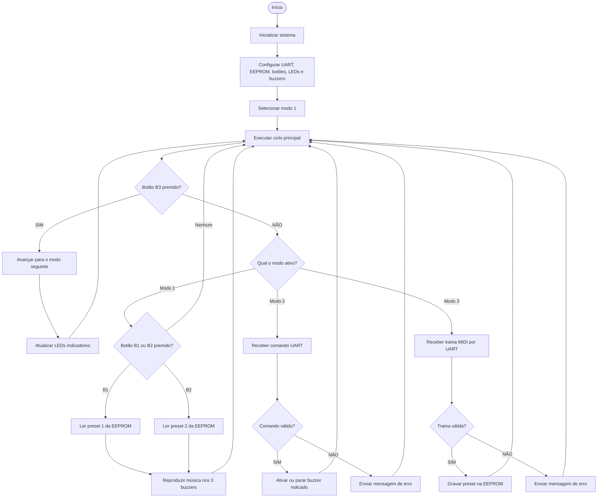

# Sistema Musical com 3 Buzzers

Firmware em C para o ATmega328P do Arduino Uno (16 MHz), com três modos:
reprodução de presets da EEPROM, reprodução de notas enviadas por UART e
gravação de novos presets a partir de ficheiros MIDI. São armazenáveis dois
presets de até 120 eventos; os botões B1 e B2 selecionam os presets 1 e 2. Os três
buzzers podem ser ativados em simultâneo e reproduzem a frequência selecionada.

## Índice

- [Objetivo](#objetivo)
- [Modos de funcionamento](#modos-de-funcionamento)
- [Hardware](#hardware)
- [Comunicação UART](#comunicação-uart)
- [Formato da trama de gravação](#formato-da-trama-de-gravação)
- [Implementação](#implementação)
- [Fluxograma](#fluxograma)
- [Limites atuais](#limites-atuais)
- [Estrutura do repositório](#estrutura-do-repositório)
- [Compilar e carregar](#compilar-e-carregar)
- [Prazos](#prazos)

## Objetivo

Sistema embebido que reproduz música em 3 buzzers (uma voz por buzzer),
alimentado por USB e controlado por botões e por um terminal série no PC.

## Modos de funcionamento

O botão B3 percorre os modos pela ordem 1 → 2 → 3 → 1. Um LED indica o modo
ativo (LED1 = modo 1, LED2 = modo 2, LED3 = modo 3). Mudar de modo interrompe
a reprodução em curso e descarta comandos ou tramas incompletos.

| Modo | Descrição |
| --- | --- |
| 1 – Presets | B1 toca o preset 1 e B2 toca o preset 2, guardados na EEPROM. Os três buzzers reproduzem as frequências dos eventos. |
| 2 – Live | O PC envia um ou mais comandos `B<buzzer>_<Hz>_<ms>` por UART. Cada comando toca no buzzer indicado sem guardar a nota; duração `0` pára esse buzzer. |
| 3 – Gravação | O PC envia a trama binária gerada pelo conversor MIDI. A placa valida os eventos e o checksum e grava o slot 1 ou 2 na EEPROM. |

## Hardware

Pinos usados no teste atual (placa Arduino com a mesma ligação do Tinkercad):

| Função | Pino Uno | Pino AVR |
| --- | --- | --- |
| Buzzer 1 — LOUDITY LD-BZEN-1201 | D8 | PB0 |
| Buzzer 2 — LOUDITY LD-BZEN-1201 | D9 | PB1 |
| Buzzer 3 — transdutor passivo | D10 | PB2 |
| Botão 1 (música 1 no modo preset) | D2 | PD2 |
| Botão 2 (música 2 no modo preset) | D3 | PD3 |
| Botão 3 (muda de modo) | D4 | PD4 |
| LED 1 (modo 1) | D5 | PD5 |
| LED 2 (modo 2) | D6 | PD6 |
| LED 3 (modo 3) | D7 | PD7 |
| UART RX/TX | D0/D1 | PD0/PD1 |

- Microcontrolador: ATmega328P a 16 MHz.
- Alimentação: USB (5 V).
- Botões ligados a GND quando premidos; as entradas usam resistências pull-up
  internas.
- Buzzers 1, 2 e 3: LOUDITY LD-BZEN-1201, transdutores eletromagnéticos sem
  oscilador, com ressonância nominal de cerca de 2,4 kHz e tensão nominal de
  1,5 V, ligados aos pinos 8 e 9. O Timer2 gera a frequência pedida nestes
  canais.
- Os três LEDs indicam exclusivamente o modo ativo.
- Placa final: PCB própria de 2 camadas, ≤ 80 × 60 mm, desenhada em Altium 365,
  com ponte USB-UART (por exemplo CH340) e conector ISP.
- Simulação do circuito em Tinkercad.
- Usar buzzers passivos para reproduzir diferentes frequências.
- Verificar a corrente exigida por cada buzzer e usar um transistor como driver
  quando necessário; não exceder o limite de corrente dos GPIO.

## Comunicação UART

Configuração: **9600 baud, 8 bits de dados, sem paridade, 1 stop bit (8-N-1)**.
O Monitor Série deve usar 9600 baud.

### Modo live

Formato do comando:

```text
B<buzzer>_<frequência em Hz>_<duração em ms>
```

Exemplo de teste perto da frequência de ressonância dos buzzers 1 e 2:

```text
B1_2400_500 B2_2400_500
```

- Buzzer: `1` a `3`; frequência aceite: 100 Hz a 2400 Hz; duração: 50 ms a
  2000 ms.
- O firmware aplica a frequência indicada nos três buzzers passivos.
- Frequências como 100 Hz ou 200 Hz estão muito abaixo da ressonância dos
  buzzers 1 e 2 e podem soar fracas ou ásperas; 2,4 kHz serve para verificar
  primeiro o timbre na frequência nominal.
- Separar comandos com espaços, tabulações ou Enter (LF/CRLF). Cada comando é
  processado assim que chega o separador, sem esperar pelo fim da linha.
- Uma duração de `0` pára o buzzer indicado e ignora a frequência. Exemplo:
  `B2_100_0`.
- Cada comando válido recebe `OK`; uma pausa recebe `OK: pausa`; comandos
  inválidos recebem `ERRO`.
- O buffer aceita comandos até 31 caracteres; comandos maiores são rejeitados.

## Formato da trama de gravação

No modo 3, enviar os bytes binários produzidos por `src/midi_para_trama.pyw`.
Os campos são transmitidos por ordem, um byte de cada vez:

| Campo | Tamanho | Descrição |
| --- | --- | --- |
| Cabeçalho | 1 byte | `0xAA` |
| Slot | 1 byte | Música a substituir: `1` ou `2` |
| Comprimento | 2 bytes | Número de bytes dos eventos, big-endian: 3 a 360, múltiplo de 3 |
| Eventos | 3 bytes cada | Buzzer/canal (1–3), nota MIDI (0 ou 60–95), duração em unidades de 10 ms (5–200) |
| Checksum | 1 byte | XOR de todos os bytes anteriores |

- Cada preset aceita de 1 a 120 eventos. A nota MIDI `0` é uma pausa no buzzer
  desse evento; as outras notas aceites são 60–95 (C4–B6).
- A aplicação permite escolher os slots 1 e 2, que correspondem aos botões B1 e
  B2 no modo 1.
- A EEPROM só é atualizada depois de validar slot, comprimento, eventos e
  checksum. O slot fica inválido durante a escrita e só é marcado válido no
  fim.
- A alteração do formato interno da EEPROM invalida os presets gravados pelo
  firmware anterior; depois de atualizar o firmware, voltar a gravar cada
  música que se pretende manter.
- A placa responde `OK: musica <slot> gravada (<eventos> eventos)` ou `ERRO`.
- O conversor necessita de `mido` e `pyserial` (`pip install mido pyserial`).
  Para abrir a aplicação gráfica sem uma janela CMD, executar
  `src\midi_para_trama.pyw` (duplo clique no Windows). Executá-lo diretamente
  com `python` continua a abrir uma consola, pois esse comando usa o
  interpretador de consola.
- Ao abrir a porta série, o Uno reinicia; carregar em B3 até selecionar o modo
  3 quando a aplicação pedir. Fechar o Monitor Série antes de enviar. Para
  aceitar tramas de até 120 eventos, carregar no Uno o firmware atualizado
  (`pio run -e uno --target upload`); o conversor usa comprimento de dois bytes
  (`LEN_H`, `LEN_L`), incompatível com o firmware anterior.

## Implementação

- Firmware em C (`.c`): `main`, `buttons`, `buzzer`, `presets`,
  `serial_modes` e `uart`. O programa começa em `main()` (inicialização e
  ciclo infinito). O PlatformIO está configurado com o framework Arduino,
  mas o firmware não usa as APIs Arduino.
- `include/` – cabeçalhos com configuração e interfaces dos módulos.
- GPIO, Timer2, UART e EEPROM são controlados diretamente pelos registos AVR
  e pela avr-libc. Não é usada nenhuma função da biblioteca Arduino
  (`Serial`, `EEPROM`, `millis`, `digitalWrite`, etc.).
- Timer2 usa CTC, prescaler 8 e comparação a cada 20 μs para atualizar os
  sinais dos três buzzers e fornecer a base de tempo do firmware.
- `src/midi_para_trama.pyw` – conversor de ficheiros MIDI para a trama binária
  recebida no modo 3. Tem 9600 baud fixos (igual ao firmware) e mostra a trama em
  hexadecimal antes de a enviar.

## Fluxograma



## Limites atuais

- 2 músicas guardadas na EEPROM (presets 1 e 2); cada slot ocupa 242 bytes:
  2 bytes de metadados e até 240 bytes de eventos compactados, totalizando
  484 dos 1024 bytes disponíveis.
- Máximo de 120 eventos por música. A trama UART transporta os eventos em
  3 bytes cada; o firmware compacta-os para 2 bytes por evento na EEPROM.
- Gama de frequências live aceite: 100 Hz a 2400 Hz. Nos buzzers 1 e 2, o
  volume/resposta depende da frequência; a ressonância nominal é cerca de
  2,4 kHz, pelo que 100–200 Hz está muito abaixo do ponto de maior resposta.
- Os três canais usam buzzers passivos e reproduzem a altura indicada pelas
  notas dos presets.
- Timer2 é usado pelo firmware para os três buzzers e deixa de estar disponível
  para outras funções que dependam desse temporizador.
- A frequência/timbre deve ser confirmada com os buzzers e os drivers finais;
  os três canais recebem ondas quadradas geradas por software numa interrupção
  de 20 μs.
- A EEPROM do ATmega328P tem 1 KB; os dois slots usam 484 bytes.
- A EEPROM tem um número limitado de ciclos de escrita; evitar regravações
  desnecessárias.

## Estrutura do repositório

```text
.
├── docs/        # requisitos, estado da arte e documentação do projeto
├── include/     # configuração e interfaces C
├── src/         # firmware C e conversor MIDI em Python
├── platformio.ini
└── README.md
```

## Compilar e carregar

Toolchain: PlatformIO com avr-gcc e framework Arduino selecionado no
`platformio.ini` (placa Uno), ATmega328P a 16 MHz. Na raiz do projeto:

```powershell
pio run -e uno
pio run -e uno --target upload
```

O comando de upload usa a porta predefinida pelo PlatformIO. Para selecionar
uma porta específica, acrescentar `--upload-port COM3` (substituir pela porta
ligada à placa).

## Prazos

- E1: 26/10/2026 (tag `E1` no Git)
- E2: 05/11/2026
- E3: 14/12/2026
- PF: 28/01/2027
