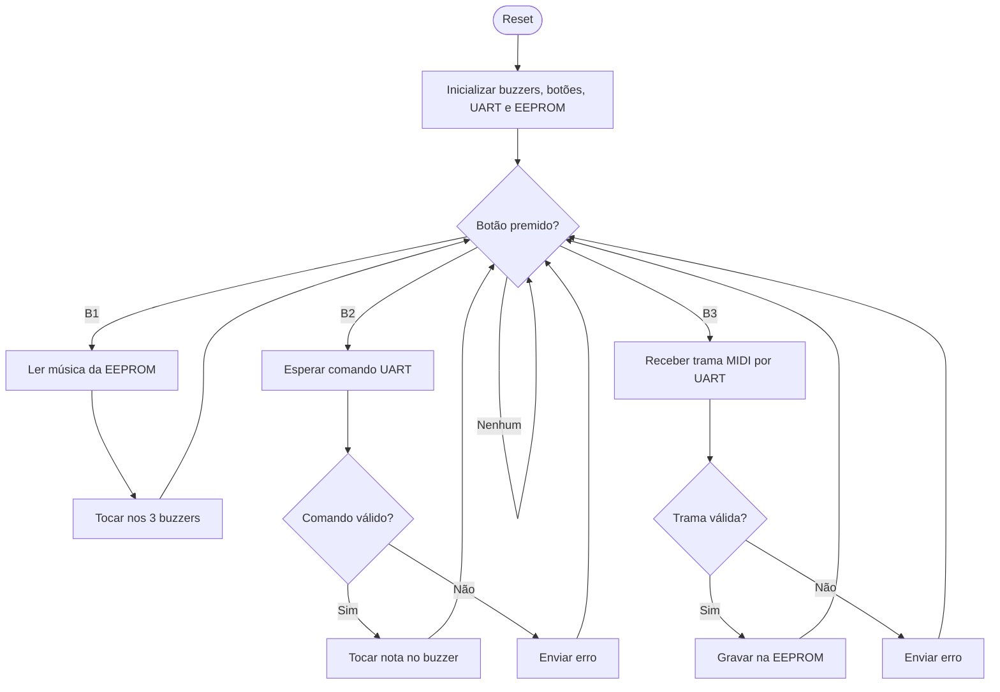

# Sistema Musical com 3 Buzzers

Firmware em C para um ATmega328P que toca música em três buzzers passivos.
Suporta músicas pré-guardadas na EEPROM (selecionadas por botão), controlo em
tempo real a partir do PC via UART e reconfiguração das músicas guardadas
através de uma trama do tipo MIDI.

> Campos marcados com `TODO` devem ser preenchidos com os valores finais do projeto.

## Índice

- [Objetivo](#objetivo)
- [Modos de funcionamento](#modos-de-funcionamento)
- [Hardware](#hardware)
- [Comunicação UART](#comunicação-uart)
- [Formato da trama de reconfiguração](#formato-da-trama-de-reconfiguração)
- [Implementação](#implementação)
- [Fluxograma](#fluxograma)
- [Limites atuais](#limites-atuais)
- [Estrutura do repositório](#estrutura-do-repositório)
- [Compilar e carregar](#compilar-e-carregar)

## Objetivo

Sistema embebido que reproduz música em 3 buzzers (uma voz por buzzer),
alimentado por USB e controlado por botões e por um terminal série no PC.

## Modos de funcionamento

| Modo | Botão | Descrição |
| --- | --- | --- |
| 1 – Preset | B1 | Seleciona e toca uma música guardada na EEPROM nos 3 buzzers. Mantém-se ativo até o sistema ser desligado. |
| 2 – Live | B2 | O PC envia nota e duração por UART e os buzzers tocam em tempo real. |
| 3 – Reconfiguração | B3 | O PC envia uma trama do tipo MIDI; o sistema valida-a e grava-a na EEPROM. Os novos presets ficam guardados. |

## Hardware

| Função | Pino Uno | Pino AVR |
| --- | --- | --- |
| Buzzer 1 | `TODO` | `TODO` |
| Buzzer 2 | `TODO` | `TODO` |
| Buzzer 3 | `TODO` | `TODO` |
| Botão 1 (preset) | `TODO` | `TODO` |
| Botão 2 (live) | `TODO` | `TODO` |
| Botão 3 (reconfiguração) | `TODO` | `TODO` |
| UART RX/TX | D0/D1 | PD0/PD1 |

- Microcontrolador: ATmega328P a 16 MHz.
- Alimentação: USB (5 V).
- Usar buzzers passivos para reproduzir diferentes frequências.
- Verificar a corrente exigida por cada buzzer e usar um transistor como driver
  quando necessário; não exceder o limite de corrente dos GPIO.

## Comunicação UART

Configuração: **9600 baud, 8 bits de dados, sem paridade, 1 stop bit (8-N-1)**.

### Modo live

Formato do comando (`TODO` confirmar):

```text
B<buzzer>_<nota ou frequência>_<duração>
```

Exemplo:

```text
B1_440_500|B2_523_500|B3_659_500|
```

- Os comandos terminam em `|`, CR ou LF.
- Cada comando recebe uma resposta de estado (aceite ou inválido).

## Formato da trama de reconfiguração

Trama do tipo MIDI enviada pelo PC no modo 3 (`TODO` definir campos finais):

| Campo | Tamanho | Descrição |
| --- | --- | --- |
| Cabeçalho | `TODO` | Marca de início da trama |
| Nº do preset | `TODO` | Posição da música na EEPROM |
| Nº de notas | `TODO` | Quantidade de eventos |
| Eventos | `TODO` | Nota, duração e buzzer de cada evento |
| Checksum | `TODO` | Validação da integridade |

- A trama só é gravada na EEPROM depois de validada.
- Em caso de erro, o preset anterior é mantido e é enviada uma mensagem de erro.

## Implementação

- `src/uart.c` – configura a USART0 e recebe bytes por interrupção para um
  buffer circular.
- `src/main.c` – máquina de estados dos 3 modos, leitura dos botões e
  interpretação dos comandos.
- `src/buzzer.c` – geração de tons de cada buzzer, com uma estrutura por buzzer
  (pino, frequência, duração restante).
- `src/eeprom.c` – leitura e escrita dos presets na EEPROM.
- `src/midi.c` – validação e descodificação da trama de reconfiguração.
- `include/` – cabeçalhos de cada módulo.

## Fluxograma



## Limites atuais

- `TODO` número máximo de músicas guardadas na EEPROM.
- `TODO` número máximo de notas por música.
- `TODO` gama de frequências suportada.
- A EEPROM do ATmega328P tem 1 KB, o que limita o espaço total para presets.
- A EEPROM tem um número limitado de ciclos de escrita; evitar regravações
  desnecessárias.

## Estrutura do repositório

```text
.
├── docs/        # requisitos, estado da arte, perguntas ao cliente
├── hardware/    # esquemas (Multisim / Altium) e lista de materiais
├── include/
├── src/
└── README.md
```

## Compilar e carregar

```text
platformio run
platformio run --target upload
```

`TODO` ajustar se o projeto usar outra toolchain.
