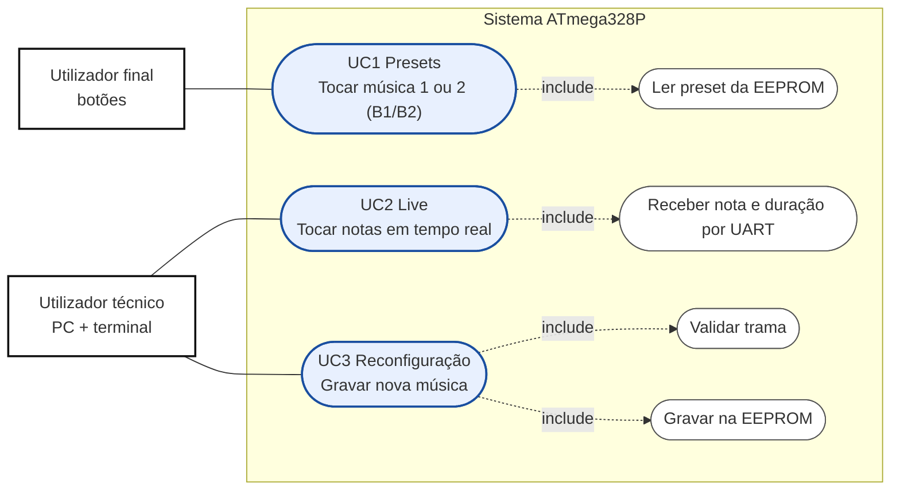
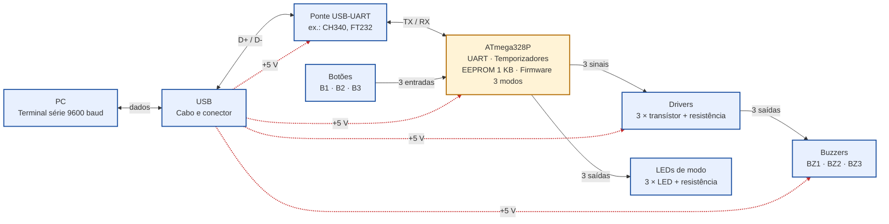

# Casos de Uso e Diagrama de Blocos (preliminar)

**Projeto:** Sistema musical com 3 buzzers (ATmega328P)

## Atores

- **Utilizador final:** escolhe e ouve músicas através dos botões.
- **Utilizador técnico:** liga o sistema ao PC por USB e usa um terminal série para tocar notas ou enviar músicas novas.

## Diagrama de casos de uso

### UC1: Presets (botões B1 e B2)

- **Ator:** utilizador final.
- **Pré-condição:** sistema alimentado por USB e com pelo menos um preset na EEPROM.
- **Fluxo principal:**
  - Com o modo preset ativo (LED1 aceso), o utilizador carrega em B1 (música 1) ou B2 (música 2).
  - O sistema lê o preset da EEPROM.
  - O sistema toca a música nos 3 buzzers, uma voz por buzzer.
  - O LED do modo preset acende.
- **Fluxos alternativos:**
  - Se a EEPROM não tiver presets válidos, o sistema não toca e indica o erro.
  - Se o utilizador carregar em B3, o som é interrompido e o sistema muda de modo.
- **Pós-condição:** os presets mantêm-se guardados depois de desligar.
- **Requisitos associados:** RF01 a RF04, RF12 a RF14.

### UC2: Live

- **Ator:** utilizador técnico.
- **Pré-condição:** PC ligado por USB e terminal aberto a 9600 baud.
- **Fluxo principal:**
  - O utilizador carrega em B3 até chegar ao modo live.
  - O LED do modo live acende.
  - O PC envia o comando `B<buzzer>_<Hz>_<ms>` por UART (ex.: `B1_300_250`).
  - O sistema recebe os dados e toca a nota em tempo real.
- **Fluxos alternativos:**
  - Se a nota estiver fora da gama ou a duração for inválida, o sistema ignora o pedido e responde com erro.
  - Se o utilizador carregar em B3, o som é interrompido e o sistema muda de modo.
- **Pós-condição:** nada é gravado na EEPROM.
- **Requisitos associados:** RF01, RF05 a RF07, RF12 a RF14.

### UC3: Reconfiguração

- **Ator:** utilizador técnico.
- **Pré-condição:** PC ligado por USB e terminal aberto a 9600 baud.
- **Fluxo principal:**
  - O utilizador carrega em B3 até chegar ao modo de reconfiguração.
  - O LED do modo de reconfiguração acende.
  - O PC envia uma trama tipo MIDI por UART.
  - O sistema valida a trama (cabeçalho, comprimento e checksum).
  - O sistema grava a música numa das 2 posições de preset da EEPROM e responde "OK".
  - A música fica disponível como novo preset em UC1.
- **Fluxos alternativos:**
  - Se a trama for inválida, o sistema responde "ERRO" e não altera a EEPROM.
  - Se a música não couber na EEPROM, o sistema responde com erro e mantém as músicas existentes.
- **Pós-condição:** os novos presets ficam guardados depois de desligar.
- **Requisitos associados:** RF08 a RF12, RF14.

## Diagrama de blocos

As setas a tracejado vermelho são a alimentação de 5 V vinda do USB. O GND é comum a todos os blocos e não está desenhado.

### Blocos

- **PC:** envia notas e tramas por terminal série (9600 baud).
- **USB:** cabo e conector; leva dados ao PC e fornece os 5 V de alimentação.
- **Ponte USB-UART:** converte os sinais USB em UART (TX/RX). Exemplos de integrados: CH340 ou FT232 (a escolher).
- **ATmega328P:**
  - UART para comunicar com o PC.
  - Temporizadores para gerar os 3 tons.
  - EEPROM de 1 KB para guardar os presets.
  - Firmware com os 3 modos.
- **Drivers:** 3 circuitos (transístor + resistência) que alimentam os buzzers a partir dos sinais do microcontrolador.
- **Buzzers:** 3 buzzers, um por voz.
- **Botões:** B1 e B2 tocam as músicas 1 e 2 no modo preset; B3 muda de modo (3 entradas).
- **LEDs de modo:** 3 LEDs com resistência em série, um por modo (3 saídas).
- **Alimentação:** 5 V vindos do USB para a ponte, o microcontrolador, os drivers e os buzzers, com GND comum.

## Pontos a decidir antes da aula 03

- Ponte USB-UART: integrado dedicado ou módulo pronto.
- Tipo de buzzer (passivo, para gerar frequências diferentes) e corrente que consome, para dimensionar os drivers.
- Se o consumo total fica dentro de RNF01 (≤ 150 mA).
- Atribuição de pinos do ATmega328P (UART, 3 saídas de tom, 3 botões, 3 LEDs).
- Formato da trama do modo 3 (cabeçalho, comprimento, dados, checksum), com 2 posições de preset.
